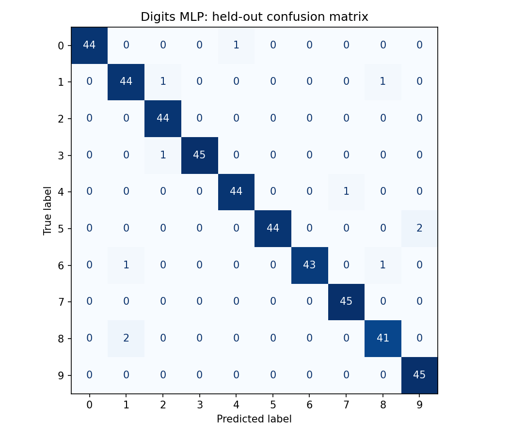

# 本次运行结果

由 `main.py` 实际运行后生成。重新运行可能随依赖版本略有变化。
教学或模拟数据指标不代表真实业务效果。

```json
{
  "dummy_majority": {
    "accuracy": 0.10222222222222223,
    "macro_f1": 0.018548387096774192
  },
  "logistic_regression": {
    "accuracy": 0.9777777777777777,
    "macro_f1": 0.9776411985388958
  },
  "mlp": {
    "accuracy": 0.9755555555555555,
    "macro_f1": 0.9755377884369884
  }
}
```



完整输出：[`outputs/metrics.json`](outputs/metrics.json)。
